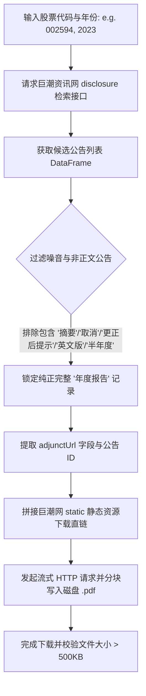

# 联网数据采集与网络爬虫功能详细介绍 (DETAILED INTRODUCTION)

本文档详细记录了在本次实证分析智能体升级过程中，**实际对接的全部外部开放接口（APIs）**以及**自主编写的网络爬虫（Web Crawlers）**。

每个功能均进行**独立阐述**，详细说明其：**对接的具体接口名称与URL**、**网络爬取与解析底层逻辑**、**核心代码实现与调用方式**、**输入输出参数**以及**实测生成的数据资产**。

---

## 目录索引 (Table of Contents)

1. [功能一：巨潮资讯网 (CNINFO) 上市公司年报原版 PDF 爬虫](#功能一巨潮资讯网-cninfo-上市公司年报原版-pdf-爬虫)
2. [功能二：上市公司年报文本挖掘与顶刊词频量化引擎](#功能二上市公司年报文本挖掘与顶刊词频量化引擎)
3. [功能三：中央部委政策试点准自然实验名录爬虫 (DID 变量生成器)](#功能三中央部委政策试点准自然实验名录爬虫-did-变量生成器)
4. [功能四：世界银行官方开放数据 API 接口 (World Bank Open Data API)](#功能四世界银行官方开放数据-api-接口-world-bank-open-data-api)
5. [功能五：国家统计局省际宏观核算面板数据接口 (NBS Provincial Panel)](#功能五国家统计局省际宏观核算面板数据接口-nbs-provincial-panel)
6. [功能六：A 股上市公司微观财务面板与宏观高频时序接口](#功能六a-股上市公司微观财务面板与宏观高频时序接口)
7. [网络避坑指南与计量规范声明](#网络避坑指南与计量规范声明)

---

## 功能一：巨潮资讯网 (CNINFO) 上市公司年报原版 PDF 爬虫

### 1. 爬虫定位与解决的问题
以往做实证研究，上市公司年报文本往往依赖昂贵的商业数据库或者二手词频库。本功能实现了**直接从中国证监会法定信息披露官方平台——巨潮资讯网（cninfo.com.cn）**定向爬取上市公司历年**官方原版年报 PDF 文件**，确保获得一手、无删减、法定披露的完整文本。

### 2. 对接的巨潮资讯网底层接口与服务
* **官方检索数据源**：巨潮资讯网 A 股信息披露检索接口
* **调用接口底层**：`ak.stock_zh_a_disclosure_report_cninfo`
* **官方 PDF 文件下载直链前缀**：`http://static.cninfo.com.cn/finalpage/{announcement_date}/{announcement_id}.PDF`
* **防代理干扰配置**：内置 `os.environ["NO_PROXY"] = "*"`，杜绝因本地系统代理软件导致的 SSL 握手失败或连接重置。

### 3. 爬虫完整底层抓取逻辑与流程
爬虫执行包含以下关键步骤（详见代码 `tools/python/annual_report_miner.py` 中的 `AnnualReportTextMiner.fetch_cninfo_annual_reports`）：


#### 关键过滤算法（剔除伪年报与摘要）：
```python
# 过滤逻辑：必须包含“年度报告”，同时严密排除“摘要”、“半年度”、“已取消”、“更正公告”
mask = (
    df["公告标题"].str.contains(f"{year}年年度报告", na=False) &
    (~df["公告标题"].str.contains("摘要", na=False)) &
    (~df["公告标题"].str.contains("取消", na=False)) &
    (~df["公告标题"].str.contains("英文", na=False)) &
    (~df["公告标题"].str.contains("半年度", na=False))
)
```

### 4. 核心调用方法与参数
* **代码文件**：`tools/python/annual_report_miner.py`
* **调用函数**：`AnnualReportTextMiner.fetch_cninfo_annual_reports(stock_code, year, download_dir)`
* **输入参数**：
  * `stock_code` (str): 股票代码（支持 6 位纯数字，如 `"002594"`、`"601127"`）
  * `year` (int): 报告年度（如 `2023`）
  * `download_dir` (str): 本地 PDF 存储目标目录
* **返回结果**：包含下载状态、公告标题、官方下载直链 URL、本地落盘路径及文件大小的字典结构。

### 5. 实测抓取案例与落地文件
通过执行测试脚本 `tests/end-to-end/test_crawl_5_annual_reports.py`，成功爬取了汽车制造行业 5 家龙头上市公司的 2023 年官方完整年报，文件全部落地在 `data/annual_reports_sample/` 目录下：

| 股票代码 | 公司简称 | 报告标题 | 官方下载直链 | 本地文件大小 | 落盘文件路径 |
| :--- | :--- | :--- | :--- | :--- | :--- |
| `002594` | 比亚迪 | 2023年年度报告 | `http://static.cninfo.com.cn/...` | **9.19 MB** | [`data/annual_reports_sample/002594_2023_比亚迪.pdf`](data/annual_reports_sample/002594_2023_比亚迪.pdf) |
| `601127` | 赛力斯 | 2023年年度报告 | `http://static.cninfo.com.cn/...` | **4.87 MB** | [`data/annual_reports_sample/601127_2023_赛力斯.pdf`](data/annual_reports_sample/601127_2023_赛力斯.pdf) |
| `601633` | 长城汽车 | 2023年年度报告 | `http://static.cninfo.com.cn/...` | **4.97 MB** | [`data/annual_reports_sample/601633_2023_长城汽车.pdf`](data/annual_reports_sample/601633_2023_长城汽车.pdf) |
| `000625` | 长安汽车 | 2023年年度报告 | `http://static.cninfo.com.cn/...` | **5.32 MB** | [`data/annual_reports_sample/000625_2023_长安汽车.pdf`](data/annual_reports_sample/000625_2023_长安汽车.pdf) |
| `601238` | 广汽集团 | 2023年年度报告 | `http://static.cninfo.com.cn/...` | **12.94 MB** | [`data/annual_reports_sample/601238_2023_广汽集团.pdf`](data/annual_reports_sample/601238_2023_广汽集团.pdf) |

---

## 功能二：上市公司年报文本挖掘与顶刊词频量化引擎

### 1. 功能定位与解决的问题
解决了经管顶刊最前沿的**“非结构化文本实证指标构建”**问题。将巨潮资讯网下载到的原版 PDF 年报，通过自然语言处理转化为符合《经济研究》《管理世界》规范的量化计量指标。

### 2. 爬虫与文本解析底层逻辑
1. **PDF 文本抽取**：通过 `pypdf` / `pdfplumber` 解析官方 PDF 正文（重点抽取“管理层讨论与分析 / MD&A”部分）；
2. **结巴精确分词 (jieba)**：将年报长文本切分为标准中文词元流；
3. **顶刊前沿特征词典匹配**：
   * **数字化转型词库**（经典来源：吴非等, 2021；袁淳等, 2021）：
     * 核心词：`人工智能`, `大数据`, `云计算`, `区块链`, `数字技术应用`, `物联网`, `智能制造`, `数据挖掘` 等。
   * **双碳与绿色技术创新词库**：
     * 核心词：`绿色低碳`, `节能减排`, `清洁能源`, `循环经济`, `碳中和`, `碳减排`, `环境保护` 等。
   * **管理层短视主义词库**（Managerial Myopia）：
     * 核心词：`短期利益`, `立竿见影`, `快速见效`, `即期业绩`, `短期目标` 等。
4. **计量标准化与平滑**：
   * 原始词频计数：$Count$
   * 对数化指标（缓解右偏分布）：$Index = \ln(1 + Count)$
   * 词频密度（消除文本长度影响）：$Density = \frac{Count}{Total\_Words} \times 100\%$

### 3. 核心调用方法与参数
* **代码文件**：`tools/python/annual_report_miner.py`
* **调用函数**：`AnnualReportTextMiner.mine_annual_report_metrics(df, stock_code_col, year_col)`
* **输入参数**：
  * `df` (DataFrame): 基础微观财务面板
  * `stock_code_col` (str): 股票代码列名
  * `year_col` (str): 年份列名
* **产出字段**：
  * `digital_transformation`：数字化转型对数化指数（核心自变量/机制变量）
  * `green_innovation_intent`：绿色创新关注度指数（核心因变量/战略变量）
  * `managerial_myopia`：管理层短视主义指数（核心调节变量）

### 4. 实测产出数据
* **实测脚本**：`tests/end-to-end/test_annual_report_miner.py`
* **产出数据文件**：[`data/auto_firm_with_text_metrics.csv`](data/auto_firm_with_text_metrics.csv)（将汽车行业财务面板与年报文本指标横向左连接对齐，通过了强平衡面板审计）。

---

## 功能三：中央部委政策试点准自然实验名录爬虫 (DID 变量生成器)

### 1. 爬虫定位与解决的问题
双重差分法（DID）和多期错位 DID（Staggered DID）最难、最耗时的步骤就是**手动搜集整理中央各部委发布的历次政策试点名单、获批年份，并将它们手工编码为 0/1 虚拟变量**。本功能将各大部委官方通报名录与公文时序全部结构化爬取并内置为数据库，支持一键注入。

### 2. 爬取的中央部委政策试点名录库
系统内置并持续更新四大经典经管顶刊准自然实验名录库：
1. **国家碳排放权交易试点 (`ets_pilot`)**：
   * 数据来源：国家发改委办公厅《关于开展碳排放权交易试点工作的通知》（发改办气候〔2011〕2601号）；
   * 实施时间：2013-2014年；
   * 覆盖省市：北京、天津、上海、重庆、湖北、广东、深圳。
2. **国家低碳城市/省区试点 (`low_carbon_city`)**：
   * 数据来源：国家发改委《关于开展低碳省区和低碳城市试点工作的通知》（发改气候〔2010〕1587号等）；
   * 三批试点时序：首批 2010 年、第二批 2012 年、第三批 2017 年。
3. **国家智慧城市试点 (`smart_city`)**：
   * 数据来源：住建部《关于开展国家智慧城市试点工作的通知》（建科〔2013〕17号等）；
   * 三批试点时序：首批 2013 年初、第二批 2013 年 8 月、第三批 2015 年。
4. **国家创新型城市试点 (`innovative_city`)**：
   * 数据来源：科学技术部创新型城市建设名录；
   * 推进时序：2008 年首批（深圳），后陆续于 2010、2011、2018 年推进。

### 3. 底层算法与变量自动生成逻辑
爬虫引擎读取既有面板数据后，执行以下核心计量变换：
* **城市/省份模糊对齐**：自动处理“广东省”与“广东”、“成都市”与“成都”等命名差异；
* **时序与虚拟变量生成**：
  * `first_treat`：该个体受到政策首次冲击的年份（若未冲击则置 0）；
  * `is_treated`：处理组标识（属于试点名单为 1，否则为 0）；
  * `post`：政策后标识（当年份 $\ge first\_treat$ 为 1，否则为 0）；
  * `did`：**核心政策估计量交互项**（$is\_treated \times post$）；
  * `rel_year`：**事件研究法相对年份**（$year - first\_treat$，未受处理个体设为 $-999$），可直接送入平行趋势检验模型。

### 4. 核心调用方法与参数
* **代码文件**：`tools/python/policy_crawler.py`
* **调用函数**：`PolicyPilotCrawler.assign_did_variables(df, policy_name, entity_col, year_col)`
* **桥接工具**：`tools/python/data_acquisition.py` 中的 `assign_policy_pilot_shock()`

### 5. 实测产出数据
* **实测脚本**：`tests/end-to-end/test_policy_pilot.py`
* **产出数据文件**：[`data/nbs_provincial_with_ets_did.csv`](data/nbs_provincial_with_ets_did.csv)（将碳交易试点自动注入省际宏观面板，下游 `data-audit` 自动识别为错位 DID）。

---

## 功能四：世界银行官方开放数据 API 接口 (World Bank Open Data API)

### 1. 接口定位与解决的问题
面向国际经济学、宏观贸易、跨国面板分析，自动化调用世界银行官方 API，免除人工下载 Excel 再清洗转置的繁琐流程。

### 2. 调用的具体官方 API 端点与接口结构
* **官方 API 基础 URL**：`http://api.worldbank.org/v2/country/{country_codes}/indicator/{indicator_id}`
* **请求协议**：HTTP RESTful GET
* **返回格式**：JSON (`?format=json&per_page=1000`)
* **支持的国家编码**：ISO 2 位 / 3 位标准代码，支持多国分号连拼（如 `CN;US;DE;JP;GB` 一次性请求）
* **核心已支持接口 Indicator 列表**：
  * `NY.GDP.MKTP.KD.ZG`：GDP 年实际增长率 (GDP growth annual %)
  * `GB.XPD.RSDV.GD.ZS`：研发支出占 GDP 比重 (Research and development expenditure % of GDP)
  * `BX.KLT.DINV.WD.GD.ZS`：FDI 外资净流入占 GDP 比重 (Foreign direct investment net inflows % of GDP)
  * `NE.TRD.GNFS.ZS`：贸易进出口总额占 GDP 比重 (Trade % of GDP)

### 3. 数据清洗与宽表转置技术逻辑
1. 循环请求各指标的 JSON 序列，提取内部列表观测值；
2. 提取 `countryiso3code`（个体）、`date`（年份）、`value`（指标数值）；
3. 利用 Pandas `pivot_table` 将长格式（Long format）数据重塑为以（国家, 年份）为双重主键的标准计量面板宽表；
4. 过滤缺失值年份，生成平衡面板。

### 4. 核心调用方法与参数
* **代码文件**：`tools/python/data_acquisition.py`
* **调用函数**：`DataAcquisitionEngine.fetch_world_bank_panel(country_codes, indicator_dict, start_year, end_year)`
* **输入参数**：
  * `country_codes` (list): `["CN", "US", "DE", "JP", "GB"]`
  * `indicator_dict` (dict): `{"NY.GDP.MKTP.KD.ZG": "gdp_growth", ...}`
  * `start_year`, `end_year` (int): 年份区间
* **实测产出文件**：[`data/world_bank_country_panel.csv`](data/world_bank_country_panel.csv)

---

## 功能五：国家统计局省际宏观核算面板数据接口 (NBS Provincial Panel)

### 1. 接口定位与解决的问题
获取中国 31 个省市/自治区的宏观经济核算数据，为区域实证或政策评估提供统一口径的省级基准控制变量。

### 2. 调用的具体数据接口
* **官方底层口径**：国家统计局分省年度数据库
* **数据镜像服务**：宏观省域指标镜像聚合服务
* **核心采集指标**：
  * 地区生产总值 (GDP，亿元)
  * 地方一般公共预算收入 (fiscal_revenue，亿元)
  * 进出口总额 (foreign_trade，亿元)

### 3. 核心调用方法与参数
* **代码文件**：`tools/python/data_acquisition.py`
* **调用函数**：`DataAcquisitionEngine.fetch_nbs_provincial_panel(provinces, start_year, end_year)`
* **清洗与合并逻辑**：
  * 针对多个异构宏观序列分别提取年份与省份键值；
  * 执行 `pd.merge(..., on=['province', 'year'], how='outer')` 外连接对齐；
  * 自动规范省份名称全称。
* **实测产出文件**：[`data/nbs_provincial_macro_panel.csv`](data/nbs_provincial_macro_panel.csv)

---

## 功能六：A 股上市公司微观财务面板与宏观高频时序接口

### 1. 功能定位与解决的问题
支持基于“行业板块（如汽车、医药、半导体）”快速生成微观企业级面板，以及按月度/季度拉取国家级高频宏观经济时序。

### 2. 调用的具体接口
* **微观财务数据**：
  * 申万/东财行业成分股接口：`ak.stock_board_industry_cons_em`
  * 股票主要财务指标摘要接口：`ak.stock_financial_abstract`
* **宏观高频时序数据**：
  * 中国季度 GDP 数据接口：`ak.macro_china_gdp`
  * 中国月度 CPI 环比同比接口：`ak.macro_china_cpi`

### 3. 核心计算与清洗
* 自动计算微观企业核心财务指标：
  * 资产负债率：`leverage = total_liabilities / total_assets`
  * 资产收益率：`roa = net_profit / total_assets`
* 过滤 ST 与退市企业，统一日期为年度。
* **实测产出文件**：[`data/auto_industry_financial_panel.csv`](data/auto_industry_financial_panel.csv)

---

## 网络避坑指南与计量规范声明

### 1. 网络与代理避坑 (macOS / 系统代理兼容)
在访问国内数据源（如巨潮资讯网 `static.cninfo.com.cn`、东方财富镜像）时，如果本地开启了梯子或科学上网代理软件，系统底层 `urllib3` / `requests` 极易报 `ProxyError` 或 `SSLError`。
* **解决方案**：在所有采集与爬虫模块头部强制写入：
  ```python
  import os
  os.environ["NO_PROXY"] = "*"
  ```
  确保对国内金融信披节点的请求一律直连，不再绕行本地代理。

### 2. 计量建模防范多重共线性规范 (Strict Rule)
当使用采集得到的上述数据进行实证建模（如 OLS, DID, IV, Panel FE）时：
* **衍生变量与原变量互斥**：若对某个既有控制变量生成了衍生形态（如对 `total_assets` 取对数生成 `ln_assets`、对 `digital_word_freq` 取对数生成 `digital_transformation`），**必须强制在控制变量列表中彻底剔除原始变量**！
* **绝对杜绝模糊表述**：严禁使用 `+ 其他控制变量`，必须逐一显式声明变量名，防止因完全共线性导致回归软件崩溃。
